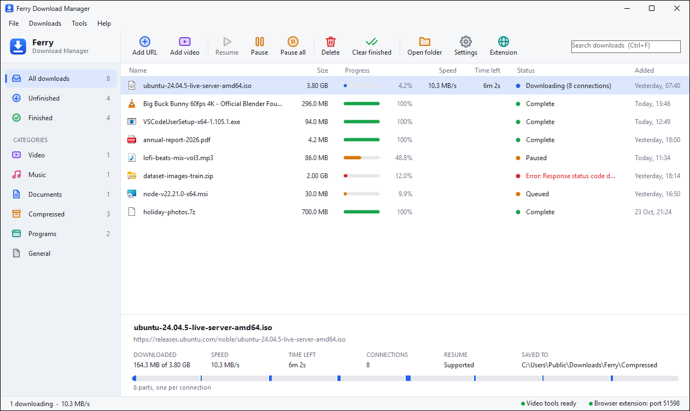
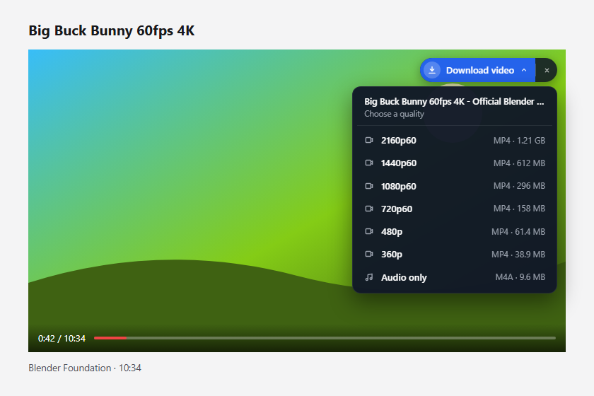
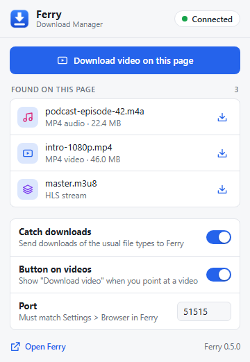

# Ferry

**A free, open-source download manager for Windows.** An alternative to Internet Download Manager (IDM): multi-connection downloads, pause and resume, a browser extension that catches downloads, and video downloads from YouTube and about 1,800 other sites.

[](https://github.com/tanzeel152/Ferry/releases/latest)
[](https://github.com/tanzeel152/Ferry/releases)
[](https://github.com/tanzeel152/Ferry/actions/workflows/build.yml)
[](LICENSE)

<picture>
  <source media="(prefers-color-scheme: dark)" srcset="screenshots/main-dark.png">
  
</picture>

Ferry was called OSDM (Open Source Download Manager) up to version 0.4. See [Upgrading from OSDM](#upgrading-from-osdm).

## Download

Get the latest version from the **[Releases page](https://github.com/tanzeel152/Ferry/releases/latest)**:

| File | What it is |
|---|---|
| `Ferry-Setup-<version>.exe` | **Installer (recommended).** Installs Ferry with Start menu shortcuts and an uninstaller. |
| `Ferry-<version>-portable.zip` | `Ferry.exe` and the browser extension, to run without installing. |
| `Ferry-<version>-browser-extension.zip` | The Chrome/Edge extension on its own. |
| `SHA256SUMS.txt` | Checksums, to check that a download is complete and unchanged. |

Ferry runs on 64-bit Windows 10 and 11 and does not need .NET installed.

> **"Windows protected your PC"?** Ferry's releases are not code-signed yet, so Microsoft Defender SmartScreen warns about them until enough people have run them. Click **More info**, then **Run anyway**. Every release is built from this repository by [GitHub Actions](.github/workflows/release.yml), and you can check it against `SHA256SUMS.txt`. If Windows 11's **Smart App Control** is on, it may block unsigned programs with no option to run them.

## Features

- **Multi-connection downloads.** Each file is split into up to 32 byte ranges that download in parallel. When a connection finishes early, it takes over half of the largest remaining range, so every connection stays busy.
- **Pause and resume**, including after closing Ferry or restarting Windows. Uses HTTP `Range` and `If-Range`, so a file that changed on the server is not stitched together wrongly.
- **Download window** with a sidebar of categories (with counts), a big-icon toolbar, search, a download list with file icons, progress bars and colored status, and a details panel that shows how far each connection has got. A tray icon and completion notifications.
- **Light and dark themes**, following Windows by default (Settings > General > Appearance). All icons are Ferry's own, drawn in code.
- **Browser extension** (Chrome and Edge) that:
  - takes over downloads of the file types you choose
  - adds right-click menus ("Download with Ferry", "Download video on this page")
  - shows a **Download video ▾** panel in the corner of any large video you point at. It opens a menu of that video's qualities with their sizes (4320p … 144p, Audio only), read by Ferry with yt-dlp in a few seconds. The **✕** hides the panel for that video; the popup can turn it off everywhere.
  - detects HLS/DASH streams and media files on the page and lists them in its popup, which also shows whether Ferry is running and can bring its window up
- **Video downloads** from YouTube and about 1,800 other sites, plus HLS (`.m3u8`) and DASH (`.mpd`) streams, using yt-dlp and FFmpeg. They use several connections too: stream pieces download in parallel, and YouTube videos are fetched in 10 MB pieces. The quality picked in the browser shows in Ferry's download window, where it can be changed (or set to one of the Settings presets).
- Speed limit, proxy (HTTP or SOCKS), retries, automatic file naming (`Content-Disposition`, de-duplicated names), clipboard monitoring, drag and drop, single instance (`Ferry.exe <url>` hands the URL to the running copy).

| Download video, in the quality you pick | The extension's popup |
|---|---|
|  | <picture><source media="(prefers-color-scheme: dark)" srcset="screenshots/extension-popup-dark.png"></picture> |

## Install

Run `Ferry-Setup-<version>.exe`. It installs Ferry to `C:\Program Files\Ferry` and adds:

- Start menu and desktop shortcuts
- an entry in Control Panel > Programs and Features (and Settings > Apps) with an uninstaller
- optionally, **Start Ferry when Windows starts**: Ferry then waits in the taskbar tray to catch downloads. You can change this later under **Tools > Start Ferry when Windows starts**.

Setup and the uninstaller close a running Ferry first. Uninstalling keeps your settings, the download list and downloaded files, and removes the video tools.

To pin Ferry to the taskbar, right-click it in the Start menu and choose **Pin to taskbar** (Windows does not let programs pin themselves). If the tray icon is hidden behind the `^` arrow, turn Ferry on under Settings > Personalization > Taskbar > Other system tray icons.

To update, run the newer `Ferry-Setup-<version>.exe`. **Help > Check for updates** opens the latest release.

### Upgrading from OSDM

Run `Ferry-Setup-<version>.exe` over your OSDM install. Setup closes OSDM, keeps its video tools and uninstalls it, and keeps your "Start with Windows" choice. When Ferry first starts, it moves over OSDM's settings, download list and unfinished downloads (`.osdm` partial files become `.ferry`). Files you already downloaded stay where they are.

The browser extension has to be set up again: remove **OSDM Integration** from `chrome://extensions` (or `edge://extensions`), then load Ferry's as described below.

## Set up the browser extension

1. Start Ferry.
2. Open `chrome://extensions` (or `edge://extensions`) and turn on **Developer mode**.
3. Click **Load unpacked** and choose `C:\Program Files\Ferry\browser-extension` (or the `browser-extension` folder from the portable zip).

The extension talks to Ferry at `http://localhost:51515`. Ferry only accepts requests from browser extensions or local programs, so websites cannot add downloads. To change the port, set it in Ferry's settings and in the extension's popup.

## Video downloads

Use **Tools > Install video tools** once. It downloads:

- [yt-dlp](https://github.com/yt-dlp/yt-dlp) (Unlicense), which finds the video streams on a page. Ferry installs its plain-Python version (`yt-dlp.pyz`, 3 MB)...
- ...and the official [embeddable Python](https://www.python.org/downloads/windows/) 3.13 (PSF license, 11 MB) to run it.
- [FFmpeg](https://ffmpeg.org) (GPL build from BtbN), which merges video and audio

They go into `%LOCALAPPDATA%\Ferry\tools`. Ferry also uses an `ffmpeg.exe` placed next to `Ferry.exe` or on `PATH`. Installs from OSDM 0.3 (which used `yt-dlp.exe`) are switched over automatically when Ferry starts.

If [Node.js](https://nodejs.org), [Deno](https://deno.com) or [Bun](https://bun.sh) is installed, yt-dlp uses it to run YouTube's player scripts. That makes signed-in downloads work (needed when YouTube asks to "confirm you're not a bot") and avoids slowed-down YouTube downloads.

Notes:

- **Why not `yt-dlp.exe`?** Windows 11's **Smart App Control** blocks unsigned programs it does not know yet, and shows a "Smart App Control blocked part of this app" notice. `yt-dlp.exe` is unsigned and unpacks unsigned libraries every time it runs (one of them, `Cryptodome\Hash\_SHA1.pyd`, was blocked on every run), and each yt-dlp update starts over. All 30 program files of the embeddable Python are signed by the Python Software Foundation (and Microsoft), so Smart App Control allows them, and `yt-dlp.pyz` is Python code, not a program file.
- **Browser cookies are not sent at first.** With YouTube sign-in cookies and no JavaScript runtime, yt-dlp finds no formats ("Requested format is not available"). Ferry retries with the browser's cookies only when the site asks you to sign in (private, age-restricted or members-only videos, or YouTube's "not a bot" check).
- **Smart App Control can still block `ffmpeg.exe`** (unsigned) for a while after it is first installed ("An Application Control policy has blocked this file"). Ferry then stops with that message instead of leaving the video and sound as two files. Press **Resume** to try again; parts already downloaded are kept.
- **Speed limit:** yt-dlp applies a speed limit to each connection, so a video download uses one connection while a limit is set.
- A YouTube or other video-site link added as a **File** is switched to a video download instead of being saved as `watch.html`.

## Where data is kept

| What | Where |
|---|---|
| Settings and download list | `%APPDATA%\Ferry\settings.json`, `downloads.json` |
| Downloads | `Downloads\Ferry\<category>\` (changeable in Settings) |
| Partial files | `<file name>.ferry`, next to the final file |
| Video tools | `%LOCALAPPDATA%\Ferry\tools` |

## Report a bug or ask for a feature

Open an issue on the **[Issues page](https://github.com/tanzeel152/Ferry/issues/new/choose)**, or use **Help > Report a problem** in Ferry. Search the existing issues first; if yours is already there, add a 👍 or a comment with your details.

For a bug, please include the Ferry version (**Help > About Ferry**), your Windows version, the download link if you can share it, and what Ferry showed. Security problems should be reported privately, as described in [SECURITY.md](SECURITY.md).

## Contributing

Pull requests are welcome, from typo fixes to new features. Read [CONTRIBUTING.md](CONTRIBUTING.md) to get set up. The [Not built yet](#not-built-yet) list below is a good place to find something to work on; open an issue first for anything big, so we can agree on the approach.

You are also free to fork Ferry and change it however you like, under the terms of the [license](#license).

## Build from source

Needs the .NET 8 SDK, and Inno Setup 6 for the installer (`winget install JRSoftware.InnoSetup`).

```powershell
git clone https://github.com/tanzeel152/Ferry.git
cd Ferry
dotnet build                                            # debug build
dotnet publish Ferry\Ferry.csproj -c Release -o publish # one self-contained Ferry.exe
.\build-installer.ps1                                   # publish, then dist\Ferry-Setup-<version>.exe
```

`publish\Ferry.exe` runs on any 64-bit Windows 10/11 PC without installing .NET. The `browser-extension` folder is copied next to it.

Command line: `Ferry.exe <url>` adds a download, `--tray` starts without opening the window, `--quit` makes the running copy save and exit.

## Project layout

| Path | What it does |
|---|---|
| `Ferry.Core\HttpEngine.cs` | Multi-connection engine: probing, range splitting, workers, retries, writing to disk |
| `Ferry.Core\Net.cs` | HTTP client, request headers, redirects (cookies are not sent to other sites) |
| `Ferry.Core\VideoEngine.cs` | Runs yt-dlp and reads its progress |
| `Ferry.Core\DownloadManager.cs` | Queue, start/pause/remove, speed sampling, saving |
| `Ferry.Core\BrowserBridge.cs` | Local HTTP server for the extension |
| `Ferry.Core\Tools.cs` | Finds or installs Python, yt-dlp and FFmpeg; starts yt-dlp |
| `Ferry\MainForm*.cs` | Main window, menus, tray icon, clipboard monitoring |
| `Ferry\Sidebar.cs`, `DownloadListView.cs`, `DetailsPanel.cs`, `EmptyState.cs` | The custom-drawn parts of the main window |
| `Ferry\Theme.cs`, `FlatRenderer.cs`, `Icons.cs`, `Shapes.cs` | Light/dark colors, flat menus and toolbar, line icons |
| `Ferry\AddUrlForm.cs`, `SettingsForm.cs` | Add-download and settings windows |
| `Ferry\Program.cs` | Single instance, `--tray`, `--quit`, bringing up the running copy |
| `Ferry\StartWithWindows.cs` | The "Start with Windows" registry entry |
| `Ferry\FromOsdm.cs` | Moves settings and downloads over from OSDM, Ferry's old name |
| `browser-extension\` | Chrome/Edge extension (Manifest V3) |
| `installer\Ferry.iss`, `build-installer.ps1` | Inno Setup installer and the script that builds it |
| `.github\workflows\` | Builds every push and pull request; builds and publishes releases |

## Not built yet

- Scheduler and named queues (start/stop at set times)
- Site grabber (download every file linked from a site)
- Firefox version of the extension, and publishing the extension on the Chrome Web Store and Edge Add-ons
- Explorer right-click menu, auto-update
- Per-download speed limits, checksum verification
- Code-signed releases

Network drivers like IDM's "Advanced Integration" are not planned. They need a signed kernel driver, and the browser extension covers modern HTTPS sites anyway.

## Code signing policy

Ferry's Windows releases are not code-signed yet; we plan to sign them through [SignPath Foundation](https://signpath.org)'s free program for open-source projects. Until then, check downloads against `SHA256SUMS.txt` on the release page.

- **How releases are made:** every release is built by [GitHub Actions](.github/workflows/release.yml) from the source code in this repository. No release file is built on anyone's own computer.
- **Committers and reviewers:** [Tanzeel Ahmed (@tanzeel152)](https://github.com/tanzeel152). Changes from other contributors are reviewed by a committer before they are merged.
- **Approvers:** [Tanzeel Ahmed (@tanzeel152)](https://github.com/tanzeel152). Once signing starts, each signing request is approved by hand.
- **Privacy:** Ferry does not send information to other computers unless you ask it to. It connects to the sites you download from, and to python.org and GitHub only when you install the video tools (**Tools > Install video tools**, or once, automatically, to replace the video tools installed by OSDM 0.3). The browser extension talks only to Ferry on your own computer. Video downloads run yt-dlp, which contacts the video's site.

## License

Ferry is free software: you can redistribute it and/or modify it under the terms of the [GNU General Public License](LICENSE) as published by the Free Software Foundation, either version 3 of the License, or (at your option) any later version. In short: you may use, share and change Ferry, including in forks, as long as what you share is also open source under the GPL.

Ferry does not include yt-dlp, Python or FFmpeg. **Tools > Install video tools** downloads them from their official sources, under their own licenses (Unlicense, PSF License and GPL).
